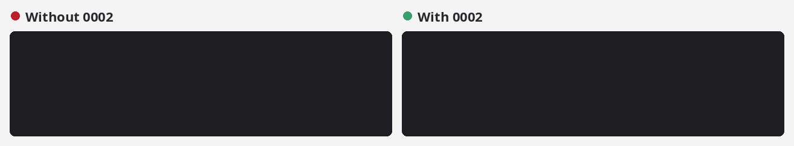
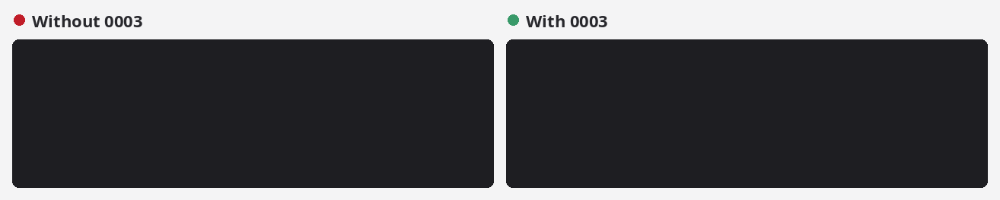
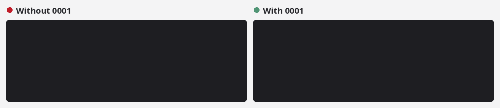
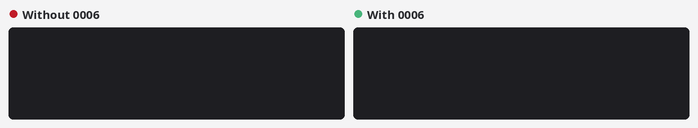
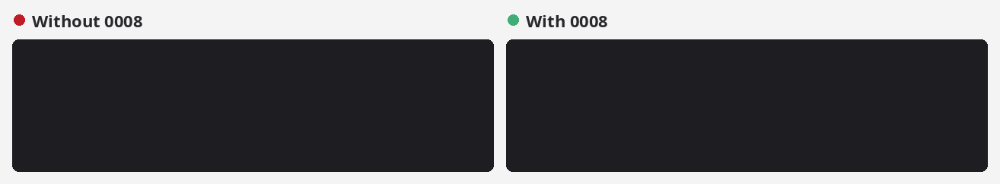
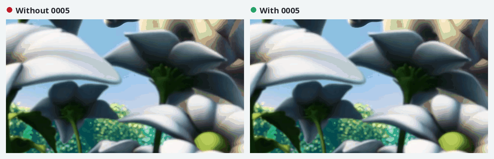
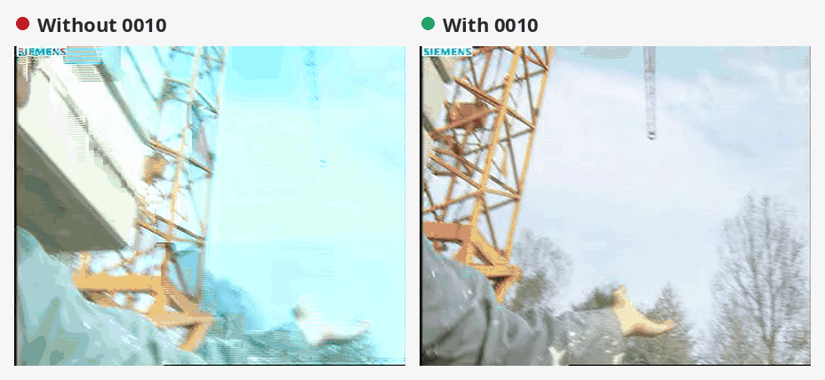
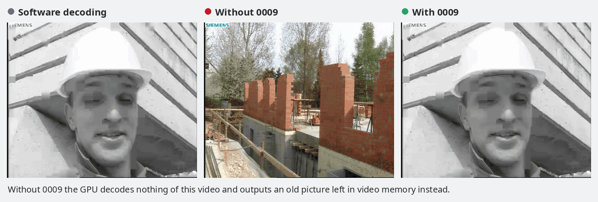
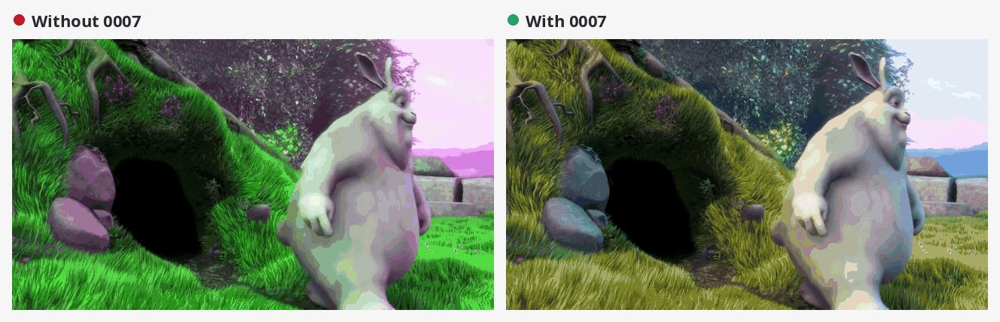
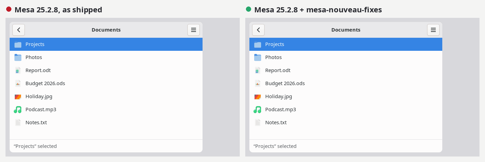

<div align="center">

  <picture>
    <source media="(prefers-color-scheme: dark)" srcset="assets/logo-dark.png">
    <source media="(prefers-color-scheme: light)" srcset="assets/logo-light.png">
    
  </picture>

### Hardware video decoding in Firefox and Brave on older NVIDIA GPUs

**Mesa fixes for nouveau, GeForce 8 to 700 series: VA-API that browsers can use, H.264 pictures that match software decoding, no GPU errors on video playback, and GTK 4 menus that draw correctly. On every GPU nouveau runs OpenGL on, from the GeForce FX on: texture clears that work.**

[](https://github.com/francesco-stimola/mesa-nouveau-fixes/actions/workflows/checks.yml)
[](https://github.com/francesco-stimola/mesa-nouveau-fixes/releases/latest)
[](LICENSE)
[](#patches)
<br>
[](https://launchpad.net/~francesco-stimola/+archive/ubuntu/mesa-nouveau-fixes)
[](https://launchpad.net/~francesco-stimola/+archive/ubuntu/mesa-nouveau-fixes)

[Fixes](#fixes) · [Results](#results) · [Patches](#patches) · [GPUs](#which-gpus-need-which-patches) · [Install](#install) · [Setup](#setup)

</div>

---

nouveau can decode H.264, MPEG-2 and VC-1 in hardware on GeForce 8 (G84 and
later) to GeForce 700 (Kepler) GPUs. `mpv --hwdec=vaapi-copy` works, but
browsers never use it, every video start fills the kernel log with GPU
errors, and some H.264 videos come out wrong. These patches fix that, a
GTK 4 bug on GeForce 8 to 300 GPUs, and `glClearTexImage`, which since Mesa
25.2 clears textures wrongly on every GPU nouveau runs OpenGL on, from the
GeForce FX on.

## Fixes

Each fix on a GeForce GT 240M (GT216, VP4). Unless the text says otherwise,
the left side is a driver with every patch but that one, the right side one
with all of them. Video panels are frames the GPU decoded; terminal panels
show the commands' output, shortened
([how they are made](assets/src/before-after)).

### Video in the browser

#### 0002 · Firefox decodes on the CPU

Firefox and Chromium only take decoded frames through
`vaExportSurfaceHandle`. nouveau decodes into interlaced buffers, with the
two fields in separate layers; no DRM PRIME layout describes that, so Mesa
refuses to export them. Firefox falls back to software decoding, which an
older CPU cannot sustain at 1080p, and `mpv --hwdec=vaapi` needs a
conversion. 0002 weaves the two fields into a progressive NV12 copy on the
GPU when a surface is first exported, and refreshes the copy after every
decode, video processing or `vaPutImage` into that surface; drivers that
decode into progressive buffers never take that path. The exported frames
match software decoding up to rounding: 0.05 on a 0–255 scale on average.

<p align="center">
  
</p>

#### 0003 · Hardware decoding stops when a clip loops

Firefox creates a new decoder when a clip loops or the user seeks. Deleting
the old decoder's engine objects passes the channel id where the DRM fd
belongs, so the objects leak, and the next decoder in the same process fails
with `-EEXIST`: Firefox turns hardware decoding off for that video. Every
nouveau GPU is affected since Mesa 24.1.

<p align="center">
  
</p>

#### 0011 · Brave decodes on the CPU on Kepler

Chromium-based browsers such as Brave, and Electron apps such as Discord,
import each decoded frame as one NV12 buffer through GBM. nvc0, the driver
for GF100 and later GPUs, works out the tiling of such a buffer from the
block size of its format, which NV12 does not have, so it accepted only
linear NV12 buffers and rejected the tiled frames it exports itself. The GPU
process kept restarting and playback fell back to software decoding. 0011
takes the tiling from the format of the first plane. Firefox and mpv import
the two planes separately and were not affected, nor were GeForce 8 to 300
GPUs. Youssef Mahmoud reported this on a GK104 and tested the fix
([issue #2](https://github.com/francesco-stimola/mesa-nouveau-fixes/issues/2)).
Kush Chandak confirmed it on a GT 710 (GK208B), where the import failed in
`eglCreateImage` instead: 582 failures in 15 seconds and a garbled picture
before, none and a correct picture with 0011
([issue #1](https://github.com/francesco-stimola/mesa-nouveau-fixes/issues/1#issuecomment-6597693583)).
Below, Brave's logs on the GK104, with the other ten patches and with all
eleven.

<p align="center">
  
</p>

### GPU errors and freezes

<a id="0001--gpu-errors-at-every-video-start"></a>

#### 0001, 0013 · GPU errors at every video start

The VA frontend clears new surfaces with plain `pipe_surface` templates.
nv50 and nvc0 read driver fields past the end of the template, so the
render target ends up 1 line high: the kernel logs
`gr: TRAP_PROP ... SURF_HEIGHT_OVERRUN` each time a player allocates its
surfaces, and some fields are never cleared.

Since Mesa 25.2 the same mistake also breaks texture clears in OpenGL:
`glClearTexImage` reaches the same code with a template on the stack.
ANGLE clears every new WebGL texture that way, so on Kepler the GPU process
of Chromium-based browsers such as Brave crashes after a few minutes of
browsing, and clears that don't crash leave the texture unchanged.
Kush Chandak found this and tested the fix on a GeForce GT 710
([!45340](https://gitlab.freedesktop.org/mesa/mesa/-/merge_requests/45340)),
with two reproducers that are now in `tests/`
([check 15](docs/TESTING.md#15-glclearteximage-clears-textures-0001)).

0013 goes with 0001: a cleanup Dave Airlie suggested when he reviewed it,
which fills the driver surface on the stack instead of allocating one at
every clear. It changes nothing visible.

<p align="center">
  
</p>

#### 0012 · Texture clears on GeForce FX, 6 and 7

nv30, the OpenGL driver of GeForce FX, 6 and 7 GPUs, has the mistake 0001
fixes in nv50 and nvc0: since Mesa 25.2, `glClearTexImage` passes its clear
hooks a template on the stack, and they read the size, pitch and offset of
the render target past its end. 0012 fills the driver surface from the
template instead. It was only built: no such GPU was at hand, so what the
bug does on them was not seen.

#### 0006 · Stopping a video can freeze the GPU

When a player closes its decoder while the GPU still works on the last
frames, the decoder deletes its engine objects too early. The kernel cannot
idle the decoder's channel (`failed to idle channel`), and the next video
that starts freezes the display until a reboot. The left side is the kernel
log from the day the bug was found: every run of it hangs the GPU.

<p align="center">
  
</p>

#### 0008 · GPU errors with YUYV and UYVY surfaces

The VA frontend clears YUYV and UYVY buffers through RGBA8 views, which hold
one block of two pixels per texel; nv50 and nvc0 size the view in pixels,
twice the buffer's width. Stock Mesa hides this, because its clears never
cover their surface (the bug 0001 fixes). With 0001 the clears write past
the end of the buffer, and the kernel logs `RT_FAULT` traps whenever a
program creates such surfaces, as mpv does when it starts.

<p align="center">
  
</p>

### Pictures that differ from the video

#### 0005 · Blocks in moving areas of H.264 videos

On VP3 to VP5 decoders ([which GPUs](#which-gpus-need-which-patches)), B
frames that use temporal direct prediction, which YouTube's H.264 streams
use in places, are decoded wrong in every player, and the errors spread to
the frames that refer to them. The decoder names the pictures that stored
motion vectors point to by their position in the reference list, and
players reorder that list at every reference frame. Below, Big Buck Bunny as
YouTube serves it in H.264 720p60.

<p align="center">
  
</p>

#### 0010 · Interlaced H.264 breaks up

Streams that mix field pictures with MBAFF frames, as TV broadcasts do,
decode into blocks and garbage on VP3 to VP5: the decoder is told that every
picture of such a stream is MBAFF coded, field pictures included. Below, an
interlaced conformance stream.

<p align="center">
  
</p>

#### 0009 · Monochrome H.264 is not decoded

The decoder is always told that the stream is 4:2:0. **With a monochrome
stream the GPU decodes nothing of the video**: what comes out is an old
picture left in video memory, the same every time, unrelated to the video.
Below, a monochrome conformance stream next to software decoding.

<p align="center">
  
</p>

#### 0007 · Converted pictures turn green and magenta

Players that cannot use the decoded surfaces directly ask VA-API to convert
frames to I420 or YV12. Mesa's shader path renders the V plane with the
shaders for both chroma planes, which write U into it. This affects every
GPU nouveau decodes video on, and other drivers without compute video
processing. With 0007 the converted frames match software decoding on all
three planes; before, the V plane was at 7 dB PSNR.

<p align="center">
  
</p>

### Outside video

#### 0004 · Garbled GTK 4 menus

On GeForce 8 to 300 GPUs, with GTK's default renderer (ngl), an open menu
and the window behind it are drawn with each other's projection, so their
content appears shrunken or stretched; the usual workaround is
`GSK_RENDERER=gl`. Small uniform buffer updates go through a hardware
binding point that can still point at the buffer's old storage, after the
buffer was orphaned, or at another context's buffer. Below, a scripted GTK 4
session on stock Mesa and with the patches
([how it is made](assets/src/gtk-menus)): at every step the window and the
menu change together, which is when the bug strikes. In everyday use the
glitches come and go; the menus of Files (GTK 4.14) draw correctly with the
patches too.

<p align="center">
  
</p>

## Results

Measured on a GeForce GT 240M (GT216, VP4) with Mesa 25.2.8 as Ubuntu 24.04
ships it, Firefox 158, and the GPU at its highest performance level
([GPU clocks](#gpu-clocks)). Frames are compared with software decoding by
MD5 ([how](docs/TESTING.md#8-h264-frames-match-software-decoding-0005)):
H.264 decoding is exact, so a correct decoder differs on no frame.

| | Mesa 25.2.8 | Mesa 25.2.8 + these patches |
|---|---|---|
| Firefox, H.264 1080p30 at 5 Mbit/s | software decoding, 87% of one core, 182 frames late in 35 s | **hardware, zero-copy, 25%, 4 frames late** |
| Firefox, the same clip in a loop | software decoding | **hardware decoding after every loop** |
| Big Buck Bunny from YouTube, H.264 720p60, 0:50–1:15 | 143 of 1501 frames differ | **none** |
| Sintel and Tears of Steel from YouTube, H.264 1080p, 25 s each | 13 of 1202 frames differ | **none** |
| FFmpeg's H.264 conformance streams that VP4 decodes | 2784 frames in 48 of 163 streams differ | **none** |
| Kernel errors during all of the above | `SURF_HEIGHT_OVERRUN` at every video start | **none** |
| Uniform buffer readbacks, [`tests/ubo-two-contexts.c`](tests/ubo-two-contexts.c): two contexts, one context orphaning its buffer | 40 of 40 and 20 of 20 wrong | **none wrong** |
| Texture clears with `glClearTexImage`, [`tests/cleartex.c`](tests/cleartex.c): depth and colour | 4083 and 4096 of 4096 texels wrong, `DATA_ERROR` in the kernel log | **none wrong, no kernel errors** |

The other 14 streams of the conformance suite use Extended profile features
or Baseline FMO and ASO, which ffmpeg does not decode through VA-API.
FFmpeg before 8.0, the one in Ubuntu 24.04 included, decodes one stream
wrongly, `slice2_field_aurora4` ([ticket 11360](https://trac.ffmpeg.org/ticket/11360)):
for it the table uses FFmpeg's reference checksums, which the GPU matches
with and without the patches.

## Patches

Each patch exists for Mesa 25.2 ([`patches/mesa-25.2`](patches/mesa-25.2),
what Ubuntu 24.04 ships), Mesa 26.0 ([`patches/mesa-26.0`](patches/mesa-26.0),
Ubuntu 26.04 and Fedora 43), Mesa 26.1 ([`patches/mesa-26.1`](patches/mesa-26.1),
Debian 13 backports and testing), Mesa 26.2 ([`patches/mesa-26.2`](patches/mesa-26.2),
Debian unstable, Fedora 44 and 45) and Mesa main
([`patches/mesa-main`](patches/mesa-main), for upstream review). They apply
with `git am` or `patch -p1`, without fuzz, to the Mesa source of these
distributions, their own patches included.

| Patch | Commit | In Mesa |
|---|---|---|
| [0001](#0001-0013--gpu-errors-at-every-video-start) | nv50,nvc0: don't read pipe_surface templates as nv50_surface in clears | approved, [!46135](https://gitlab.freedesktop.org/mesa/mesa/-/merge_requests/46135); also in [!45340](https://gitlab.freedesktop.org/mesa/mesa/-/merge_requests/45340) |
| [0002](#0002--firefox-decodes-on-the-cpu) | frontends/va: export interlaced surfaces through a progressive copy | in review, [!45340](https://gitlab.freedesktop.org/mesa/mesa/-/merge_requests/45340) |
| [0003](#0003--hardware-decoding-stops-when-a-clip-loops) | winsys/nouveau: pass the DRM fd when deleting subchannel objects | in review, [!46224](https://gitlab.freedesktop.org/mesa/mesa/-/merge_requests/46224); also in [!45340](https://gitlab.freedesktop.org/mesa/mesa/-/merge_requests/45340) |
| [0004](#0004--garbled-gtk-4-menus) | nv50: only push constant buffer updates through a current binding | in review, [!46224](https://gitlab.freedesktop.org/mesa/mesa/-/merge_requests/46224); also in [!45340](https://gitlab.freedesktop.org/mesa/mesa/-/merge_requests/45340) |
| [0005](#0005--blocks-in-moving-areas-of-h264-videos) | nouveau: keep H.264 references in the same VP slot | in review, [!45340](https://gitlab.freedesktop.org/mesa/mesa/-/merge_requests/45340) |
| [0006](#0006--stopping-a-video-can-freeze-the-gpu) | nouveau: wait for the video engines before destroying a vp3 decoder | in review, [!45340](https://gitlab.freedesktop.org/mesa/mesa/-/merge_requests/45340) |
| [0007](#0007--converted-pictures-turn-green-and-magenta) | vl/compositor: render the V plane with its own gfx shaders | in review, [!45340](https://gitlab.freedesktop.org/mesa/mesa/-/merge_requests/45340) |
| [0008](#0008--gpu-errors-with-yuyv-and-uyvy-surfaces) | nv50: size surface views by blocks when the block size differs | approved, [!46135](https://gitlab.freedesktop.org/mesa/mesa/-/merge_requests/46135); also in [!45340](https://gitlab.freedesktop.org/mesa/mesa/-/merge_requests/45340) |
| [0009](#0009--monochrome-h264-is-not-decoded) | nouveau: pass chroma_format_idc to the vp3 H.264 decoder | in review, [!45340](https://gitlab.freedesktop.org/mesa/mesa/-/merge_requests/45340) |
| [0010](#0010--interlaced-h264-breaks-up) | nouveau: tell the vp3 H.264 decoder whether a picture is MBAFF | in review, [!45340](https://gitlab.freedesktop.org/mesa/mesa/-/merge_requests/45340) |
| [0011](#0011--brave-decodes-on-the-cpu-on-kepler) | nvc0: accept tiled modifiers for planar YUV formats | in review, [!45340](https://gitlab.freedesktop.org/mesa/mesa/-/merge_requests/45340) |
| [0012](#0012--texture-clears-on-geforce-fx-6-and-7) | nv30: don't read pipe_surface templates as nv30_surface in clears | approved, [!46135](https://gitlab.freedesktop.org/mesa/mesa/-/merge_requests/46135); also in [!45340](https://gitlab.freedesktop.org/mesa/mesa/-/merge_requests/45340) |
| [0013](#0001-0013--gpu-errors-at-every-video-start) | nv50,nvc0: clear through a driver surface on the stack | approved, [!46135](https://gitlab.freedesktop.org/mesa/mesa/-/merge_requests/46135); also in [!45340](https://gitlab.freedesktop.org/mesa/mesa/-/merge_requests/45340) |

### Which GPUs need which patches

nouveau decodes video with a different engine on each GPU generation, and
the OpenGL fixes also reach the GPUs it decodes no video on. The nouveau
chipset (in brackets) is what `vainfo` prints after "for" and what
`glxinfo -B` prints as the renderer, for example `NVA5`. Some GeForce 600
and 700 models use Fermi or Maxwell chips: check the chipset.

| GPUs | Examples | Video engine | Codecs |
|---|---|---|---|
| NV30 and NV40 families (NV30–NV4E, NV63, NV67) | GeForce FX 5200–5950, GeForce 6 and 7 series, Go and integrated models included | none that VA-API can use | – |
| G80 (NV50) | GeForce 8800 GTX, 8800 GTS 320/640 | VP1, not supported by nouveau | – |
| G84–G96, GT200 (NV84–NVA0) | GeForce 8400 GS (first version), 8500 GT, 8600, 8800 GT, 9400 GT–9800 GTX, GTS 250, GTX 260–295, 8400M–9800M | VP2 | H.264, MPEG-2 |
| G98, MCP77–MCP7A (NV98, NVAA, NVAC) | GeForce 8400 GS (later versions), 9300 GS, 9200M GS, 9300M GS; integrated GeForce 8200, 8300, 9300, 9400 and ION | VP3 | H.264, MPEG-2, VC-1 |
| GT215–GT218, MCP89 (NVA3, NVA5, NVA8, NVAF) | GeForce 210, GT 220, GT 240, 310, 315, G 210M, GT 230M–GT 335M, 320M | VP4 | H.264, MPEG-2, VC-1 |
| GF100–GF116 (NVC0–NVCF) | GeForce 400 series, most of the 500 series | VP4 | H.264, MPEG-2, VC-1 |
| GF117, GF119, Kepler (NVD7, NVD9, NVE4–NV108) | GeForce GT 520, GT 610, Kepler models of the 600 and 700 series such as GT 710, GT 730, GTX 660, GTX 770 | VP5 | H.264, MPEG-2, VC-1 |
| Maxwell and later (NV117 on) | GeForce GTX 745, 750, 750 Ti and later | not supported by nouveau | – |

| Patch | NV30, NV40 families | G80 | G84–GT200 (VP2) | G98, MCP7x (VP3) | GT21x, MCP89 (VP4) | GF100–GF116 (VP4) | GF117, GF119, Kepler (VP5) | Maxwell and later |
|---|:-:|:-:|:-:|:-:|:-:|:-:|:-:|:-:|
| 0001, 0013 | | ✓ | ✓ | ✓ | ✓ | ✓ | ✓ | ✓ |
| 0012 | ✓ | | | | | | | |
| 0002 | | | ✓ | ✓ | ✓ | ✓ | ✓ | |
| 0003 | | | ✓ | ✓ | ✓ | ✓ | ✓ | |
| 0004 | | ✓ | ✓ | ✓ | ✓ | | | |
| 0005 | | | | ✓ | ✓ | ✓ | ✓ | |
| 0006 | | | | ✓ | ✓ | ✓ | ✓ | |
| 0007 | | | ✓ | ✓ | ✓ | ✓ | ✓ | |
| 0008 | | | ✓ | ✓ | ✓ | ✓ | ✓ | |
| 0009 | | | | ✓ | ✓ | ✓ | ✓ | |
| 0010 | | | | ✓ | ✓ | ✓ | ✓ | |
| 0011 | | | | | | ✓ | ✓ | |

0004 fixes the OpenGL driver of every GeForce 8 to 300 GPU, so it matters
with or without video decoding; so do 0001 and 0013, for texture clears on
every GPU from G80 on, Maxwell and later included, and 0012, for the same
clears on the NV30 and NV40 families. 0003 changes code every nouveau GPU
runs; the failure it fixes shows up when a program re-creates a video
decoder. VP2 GPUs set the two parameters 0009 and 0010 correct in the same
way, in their own decoder code (`nv84_video_bsp.c`, `nv84_video_vp.c`);
these patches leave it alone, since there was no VP2 GPU to test them on.
0011 changes code that every GF100 and later GPU runs, but the frames it
lets through come from nouveau's video decoder, which Maxwell and later
lack; it was tested on Kepler.

On Kepler, Kush Chandak tested all ten patches on a GeForce GT 710
(GK208B): H.264 and MPEG-2 decode at 1080p, H.264 identical to software
decoding, with no kernel errors. Kepler also needs two kernel fixes by
Risto Pajula, not merged yet: since Linux 6.2 the video engines fault on
the first frame, and since Linux 6.6 every frame also waits 30 seconds.
On these kernels decoding fails whatever Mesa does:
[patches](https://lore.kernel.org/nouveau/20260913201225.5975-1-or.pajula@gmail.com/).
Youssef Mahmoud also decodes H.264 in hardware on a GK104 with the patches
and these kernel fixes, in Firefox, mpv and, with 0011, Brave and Discord.

## Install

- **Ubuntu 24.04 and 26.04** and distributions based on them (Zorin OS 18,
  Linux Mint 22, ...): the
  [PPA](https://launchpad.net/~francesco-stimola/+archive/ubuntu/mesa-nouveau-fixes)
  has Ubuntu's own Mesa with these patches, for amd64 and i386; the badges at
  the top show its versions.
  ```sh
  sudo add-apt-repository ppa:francesco-stimola/mesa-nouveau-fixes
  sudo apt update
  sudo apt upgrade
  ```
- **Build it yourself**, on any distribution: a patched VA driver, to try for
  one program without touching the system Mesa; for Ubuntu 24.04 each
  release has one prebuilt ([how](docs/SETUP.md#try-it-without-installing)).
  It carries the video fixes only, not the OpenGL ones.
- **Debian** 13 with backports, testing and unstable: a script rebuilds
  Debian's own Mesa packages with the patches ([how](docs/SETUP.md#debian)).
- **Fedora** 43 to 45: a script rebuilds Fedora's own Mesa packages with the
  patches and with the H.264 decoder Fedora leaves out
  ([how](docs/SETUP.md#fedora)).

Then install the firmware, set up the browsers and fix the GPU clocks, as
[Setup](#setup) describes. GPUs that nouveau decodes no video on, such as
GeForce FX to 7, G80 and Maxwell and later, only need the patched Mesa.

## Setup

Besides the patched Mesa, a working system needs the firmware, a browser
that is allowed to use VA-API, and fixed GPU clocks.
[`docs/SETUP.md`](docs/SETUP.md) walks through all of them, with scripts:

- **Firmware.** nouveau needs the video firmware inside NVIDIA's 340.108
  driver, which only NVIDIA may distribute.
  [`scripts/install-firmware.sh`](scripts/install-firmware.sh) downloads the
  driver from nvidia.com, checks it and extracts the firmware with envytools.
- **Firefox.** Use Mozilla's `.deb`: the Snap and Flatpak builds bring their
  own Mesa. Firefox blocks VA-API on NVIDIA GPUs until
  `media.hardware-video-decoding.force-enabled` is true;
  [`scripts/setup-firefox.sh`](scripts/setup-firefox.sh) sets it for every
  profile.
- **Brave** blocks VA-API on NVIDIA GPUs too, and decodes in hardware with a
  few command-line options ([how](docs/SETUP.md#brave-and-other-chromium-browsers)).
  Other Chromium-based browsers take the same options; only Brave was
  tested.
- **GPU clocks**, below.

These decoders handle H.264, MPEG-2 and VC-1 only. VP4 (GT21x) is designed for
H.264 High up to 1080p30 (level 4.1); 1080p60 is beyond it. Sites that serve
VP9 or AV1 need an H.264-only setting, such as the enhanced-h264ify extension
for YouTube.

### GPU clocks

nouveau never changes the GPU clocks on its own: the GPU stays at the
performance level the VBIOS picked at boot, often a middle one. At that level
the decoder may be slower than the CPU, and the patches look as if they did
nothing. Check the current level, marked with `*`, as root:

```sh
sudo cat /sys/kernel/debug/dri/*/pstate
```

Set the fastest level at every boot with the kernel parameter
`nouveau.config=NvClkMode=0xf`, using the highest level your GPU lists; see
[SETUP](docs/SETUP.md#4-gpu-clocks). Levels can be changed on Tesla (GeForce 8
to 300) and most Kepler GPUs.

Do not change levels while the desktop runs. Writing a level to the `pstate`
file works most of the time, but on a GeForce GT 240M switching between levels
when the screen went off and on twice left the GPU broken: once it hung at
once, once it kept failing every frame of the desktop until it hung. Setting
the level at boot avoids both.

## Testing

[`docs/TESTING.md`](docs/TESTING.md) lists the checks used for the results
above: kernel traps, export with mpv, frame comparison with software decoding,
H.264 conformance, decoders stopped early, conversion to three-plane formats,
YUYV and UYVY surfaces, monochrome and interlaced H.264, Firefox logs,
Brave's frame imports and texture clears.

## License

MIT, like the Mesa files the patches modify. See [LICENSE](LICENSE).
