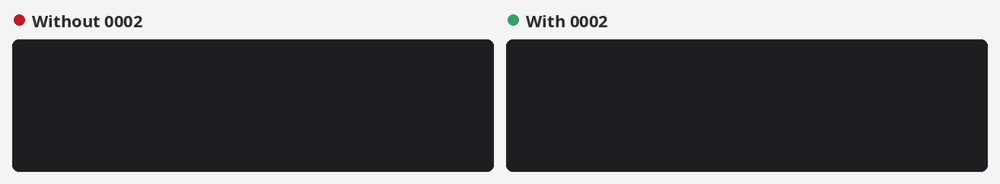
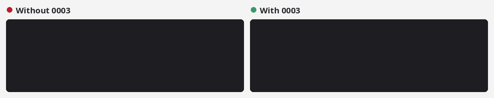
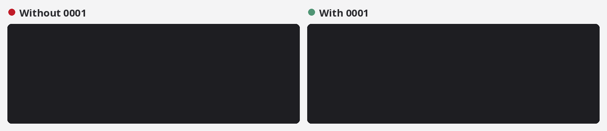
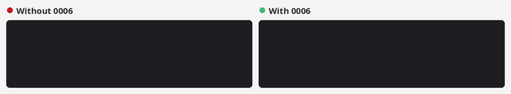
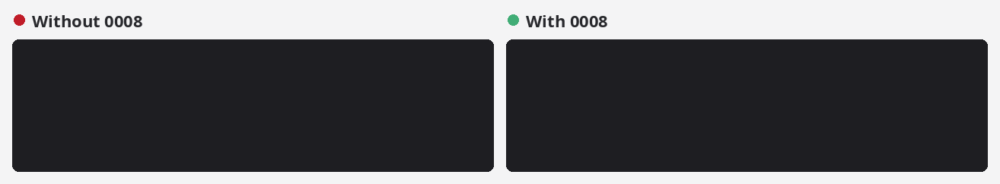
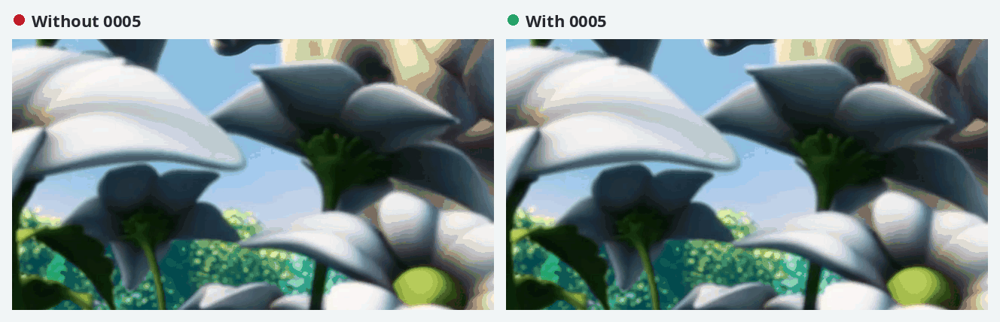
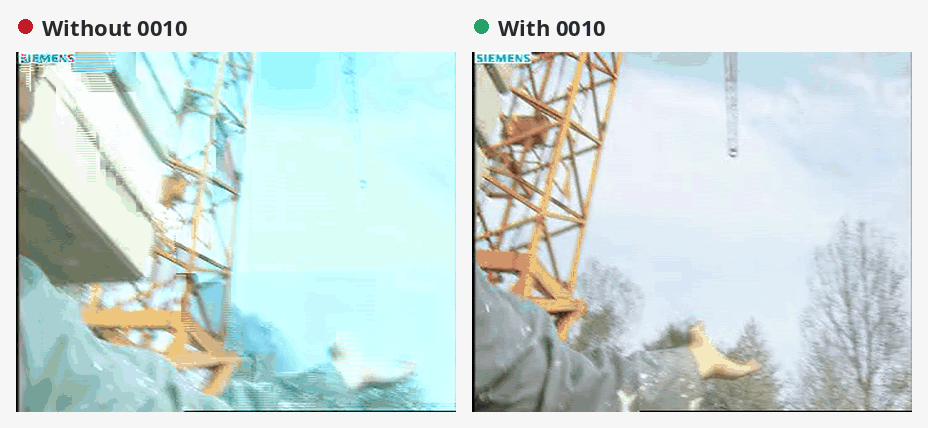
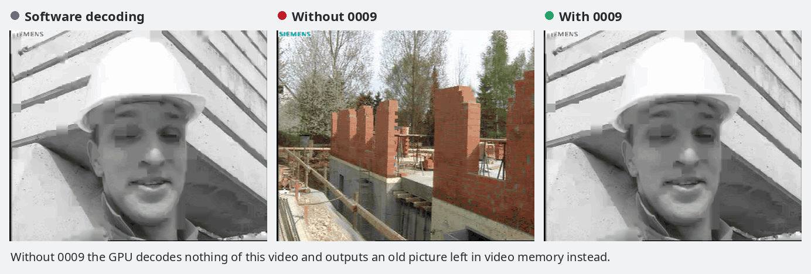
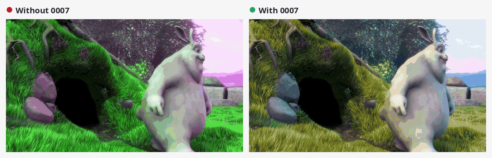
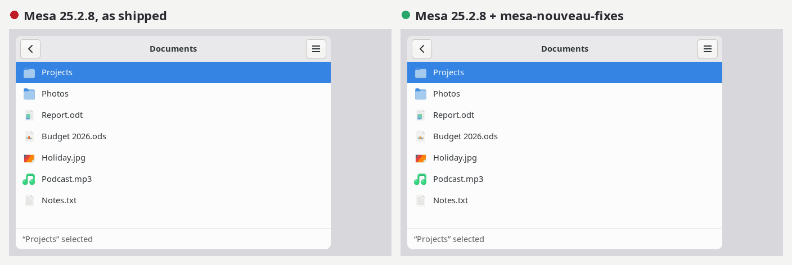

<div align="center">

  <picture>
    <source media="(prefers-color-scheme: dark)" srcset="assets/logo-dark.png">
    <source media="(prefers-color-scheme: light)" srcset="assets/logo-light.png">
    
  </picture>

### Hardware video decoding in Firefox on older NVIDIA GPUs

**Mesa fixes for nouveau, GeForce 8 to 700 series: VA-API that browsers can use, H.264 pictures that match software decoding, no GPU errors on video playback, and GTK 4 menus that draw correctly.**

[](https://github.com/francesco-stimola/mesa-nouveau-fixes/actions/workflows/checks.yml)
[](https://github.com/francesco-stimola/mesa-nouveau-fixes/releases/latest)
[](LICENSE)
[](#patches)
<br>
[](https://launchpad.net/~francesco-stimola/+archive/ubuntu/mesa-nouveau-fixes)
[](https://launchpad.net/~francesco-stimola/+archive/ubuntu/mesa-nouveau-fixes)

[Fixes](#fixes) · [Results](#results) · [Patches](#patches) · [GPUs](#which-gpus-need-which-patches) · [Install](#install) · [Setup](#setup) · [Known issues](#known-issues)

</div>

---

nouveau can decode H.264, MPEG-2 and VC-1 in hardware on GeForce 8 (G84 and
later) to GeForce 700 (Kepler) GPUs. `mpv --hwdec=vaapi-copy` works, but
browsers never use it, every video start fills the kernel log with GPU
errors, and some H.264 videos come out wrong. These patches fix that, and a
GTK 4 bug in the same driver.

## Fixes

Each fix on a GeForce GT 240M (GT216, VP4). Unless the text says otherwise,
the left side is a driver with every patch but that one, the right side one
with all of them. Video panels are frames the GPU decoded; terminal panels
show the commands' output, shortened
([how they are made](assets/src/before-after)).

### Video in the browser

#### 0002 · Firefox decodes on the CPU

Firefox and Chromium only take decoded frames through
`vaExportSurfaceHandle`. nouveau decodes into interlaced buffers, with the
two fields in separate layers; no DRM PRIME layout describes that, so Mesa
refuses to export them. Firefox falls back to software decoding, which an
older CPU cannot sustain at 1080p, and `mpv --hwdec=vaapi` needs a
conversion. 0002 weaves the two fields into a progressive NV12 copy on the
GPU when a surface is first exported, and refreshes the copy after every
decode, video processing or `vaPutImage` into that surface; drivers that
decode into progressive buffers never take that path. The exported frames
match software decoding up to rounding: 0.05 on a 0–255 scale on average.

<p align="center">
  
</p>

#### 0003 · Hardware decoding stops when a clip loops

Firefox creates a new decoder when a clip loops or the user seeks. Deleting
the old decoder's engine objects passes the channel id where the DRM fd
belongs, so the objects leak, and the next decoder in the same process fails
with `-EEXIST`: Firefox turns hardware decoding off for that video. Every
nouveau GPU is affected since Mesa 24.1.

<p align="center">
  
</p>

### GPU errors and freezes

#### 0001 · GPU errors at every video start

The VA frontend clears new surfaces with plain `pipe_surface` templates.
nv50 and nvc0 read driver fields past the end of the template, so the
render target ends up 1 line high: the kernel logs
`gr: TRAP_PROP ... SURF_HEIGHT_OVERRUN` each time a player allocates its
surfaces, and some fields are never cleared.

<p align="center">
  
</p>

#### 0006 · Stopping a video can freeze the GPU

When a player closes its decoder while the GPU still works on the last
frames, the decoder deletes its engine objects too early. The kernel cannot
idle the decoder's channel (`failed to idle channel`), and the next video
that starts freezes the display until a reboot. The left side is the kernel
log from the day the bug was found: every run of it hangs the GPU.

<p align="center">
  
</p>

#### 0008 · GPU errors with YUYV and UYVY surfaces

The VA frontend clears YUYV and UYVY buffers through RGBA8 views, which hold
one block of two pixels per texel; nv50 and nvc0 size the view in pixels,
twice the buffer's width. Stock Mesa hides this, because its clears never
cover their surface (the bug 0001 fixes). With 0001 the clears write past
the end of the buffer, and the kernel logs `RT_FAULT` traps whenever a
program creates such surfaces, as mpv does when it starts.

<p align="center">
  
</p>

### Pictures that differ from the video

#### 0005 · Blocks in moving areas of H.264 videos

On VP3 to VP5 decoders ([which GPUs](#which-gpus-need-which-patches)), B
frames that use temporal direct prediction, which YouTube's H.264 streams
use in places, are decoded wrong in every player, and the errors spread to
the frames that refer to them. The decoder names the pictures that stored
motion vectors point to by their position in the reference list, and
players reorder that list at every reference frame. Below, Big Buck Bunny as
YouTube serves it in H.264 720p60.

<p align="center">
  
</p>

#### 0010 · Interlaced H.264 breaks up

Streams that mix field pictures with MBAFF frames, as TV broadcasts do,
decode into blocks and garbage on VP3 to VP5: the decoder is told that every
picture of such a stream is MBAFF coded, field pictures included. Below, an
interlaced conformance stream.

<p align="center">
  
</p>

#### 0009 · Monochrome H.264 is not decoded

The decoder is always told that the stream is 4:2:0. **With a monochrome
stream the GPU decodes nothing of the video**: what comes out is an old
picture left in video memory, the same every time, unrelated to the video.
Below, a monochrome conformance stream next to software decoding.

<p align="center">
  
</p>

#### 0007 · Converted pictures turn green and magenta

Players that cannot use the decoded surfaces directly ask VA-API to convert
frames to I420 or YV12. Mesa's shader path renders the V plane with the
shaders for both chroma planes, which write U into it. This affects every
GPU nouveau decodes video on, and other drivers without compute video
processing. With 0007 the converted frames match software decoding on all
three planes; before, the V plane was at 7 dB PSNR.

<p align="center">
  
</p>

### Outside video

#### 0004 · Garbled GTK 4 menus

On GeForce 8 to 300 GPUs, with GTK's default renderer (ngl), an open menu
and the window behind it are drawn with each other's projection, so their
content appears shrunken or stretched; the usual workaround is
`GSK_RENDERER=gl`. Small uniform buffer updates go through a hardware
binding point that can still point at the buffer's old storage, after the
buffer was orphaned, or at another context's buffer. Below, a scripted GTK 4
session on stock Mesa and with the patches
([how it is made](assets/src/gtk-menus)): at every step the window and the
menu change together, which is when the bug strikes. In everyday use the
glitches come and go; the menus of Files (GTK 4.14) draw correctly with the
patches too.

<p align="center">
  
</p>

## Results

Measured on a GeForce GT 240M (GT216, VP4) with Mesa 25.2.8 as Ubuntu 24.04
ships it, Firefox 158, and the GPU at its highest performance level
([GPU clocks](#gpu-clocks)). Frames are compared with software decoding by
MD5 ([how](docs/TESTING.md#8-h264-frames-match-software-decoding-0005)):
H.264 decoding is exact, so a correct decoder differs on no frame.

| | Mesa 25.2.8 | Mesa 25.2.8 + these patches |
|---|---|---|
| Firefox, H.264 1080p30 at 5 Mbit/s | software decoding, 87% of one core, 182 frames late in 35 s | **hardware, zero-copy, 25%, 4 frames late** |
| Firefox, the same clip in a loop | software decoding | **hardware decoding after every loop** |
| Big Buck Bunny from YouTube, H.264 720p60, 0:50–1:15 | 143 of 1501 frames differ | **none** |
| Sintel and Tears of Steel from YouTube, H.264 1080p, 25 s each | 13 of 1202 frames differ | **none** |
| FFmpeg's H.264 conformance streams that VP4 decodes | 2834 frames in 49 of 163 streams differ | **50 frames in 1 stream** ([known issue](#known-issues)) |
| Kernel errors during all of the above | `SURF_HEIGHT_OVERRUN` at every video start | **none** |
| Uniform buffer readbacks, [`tests/ubo-two-contexts.c`](tests/ubo-two-contexts.c): two contexts, one context orphaning its buffer | 40 of 40 and 20 of 20 wrong | **none wrong** |

The other 14 streams of the conformance suite use Extended profile features
or Baseline FMO and ASO, which ffmpeg does not decode through VA-API.

## Patches

Each patch exists for Mesa 25.2 ([`patches/mesa-25.2`](patches/mesa-25.2),
what Ubuntu 24.04 ships), Mesa 26.0 ([`patches/mesa-26.0`](patches/mesa-26.0),
Ubuntu 26.04) and Mesa main ([`patches/mesa-main`](patches/mesa-main), for
upstream review). They apply with `git am` or `patch -p1`.

| Patch | Commit | In Mesa |
|---|---|---|
| [0001](#0001--gpu-errors-at-every-video-start) | nv50,nvc0: don't read pipe_surface templates as nv50_surface in clears | in review, [!45340](https://gitlab.freedesktop.org/mesa/mesa/-/merge_requests/45340) |
| [0002](#0002--firefox-decodes-on-the-cpu) | frontends/va: export interlaced surfaces through a progressive copy | in review, [!45340](https://gitlab.freedesktop.org/mesa/mesa/-/merge_requests/45340) |
| [0003](#0003--hardware-decoding-stops-when-a-clip-loops) | winsys/nouveau: pass the DRM fd when deleting subchannel objects | in review, [!45340](https://gitlab.freedesktop.org/mesa/mesa/-/merge_requests/45340) |
| [0004](#0004--garbled-gtk-4-menus) | nv50: only push constant buffer updates through a current binding | in review, [!45340](https://gitlab.freedesktop.org/mesa/mesa/-/merge_requests/45340) |
| [0005](#0005--blocks-in-moving-areas-of-h264-videos) | nouveau: keep H.264 references in the same VP slot | in review, [!45340](https://gitlab.freedesktop.org/mesa/mesa/-/merge_requests/45340) |
| [0006](#0006--stopping-a-video-can-freeze-the-gpu) | nouveau: wait for the video engines before destroying a vp3 decoder | in review, [!45340](https://gitlab.freedesktop.org/mesa/mesa/-/merge_requests/45340) |
| [0007](#0007--converted-pictures-turn-green-and-magenta) | vl/compositor: render the V plane with its own gfx shaders | not proposed yet |
| [0008](#0008--gpu-errors-with-yuyv-and-uyvy-surfaces) | nv50: size surface views by blocks when the block size differs | in review, [!45340](https://gitlab.freedesktop.org/mesa/mesa/-/merge_requests/45340) |
| [0009](#0009--monochrome-h264-is-not-decoded) | nouveau: pass chroma_format_idc to the vp3 H.264 decoder | not proposed yet |
| [0010](#0010--interlaced-h264-breaks-up) | nouveau: tell the vp3 H.264 decoder whether a picture is MBAFF | not proposed yet |

### Which GPUs need which patches

nouveau decodes video with a different engine on each GPU generation. The
nouveau chipset (in brackets) is what `vainfo` prints after "for", for
example `NVA5`. Some GeForce 600 and 700 models use Fermi or Maxwell chips:
check the chipset `vainfo` prints.

| GPUs | Examples | Video engine | Codecs |
|---|---|---|---|
| G80 (NV50) | GeForce 8800 GTX, 8800 GTS 320/640 | VP1, not supported by nouveau | – |
| G84–G96, GT200 (NV84–NVA0) | GeForce 8400 GS (first version), 8500 GT, 8600, 8800 GT, 9400 GT–9800 GTX, GTS 250, GTX 260–295, 8400M–9800M | VP2 | H.264, MPEG-2 |
| G98, MCP77–MCP7A (NV98, NVAA, NVAC) | GeForce 8400 GS (later versions), 9300 GS, 9200M GS, 9300M GS; integrated GeForce 8200, 8300, 9300, 9400 and ION | VP3 | H.264, MPEG-2, VC-1 |
| GT215–GT218, MCP89 (NVA3, NVA5, NVA8, NVAF) | GeForce 210, GT 220, GT 240, 310, 315, G 210M, GT 230M–GT 335M, 320M | VP4 | H.264, MPEG-2, VC-1 |
| GF100–GF116 (NVC0–NVCF) | GeForce 400 series, most of the 500 series | VP4 | H.264, MPEG-2, VC-1 |
| GF117, GF119, Kepler (NVD7, NVD9, NVE4–NV108) | GeForce GT 520, GT 610, Kepler models of the 600 and 700 series such as GT 710, GT 730, GTX 660, GTX 770 | VP5 | H.264, MPEG-2, VC-1 |
| Maxwell and later (NV117 on) | GeForce GTX 745, 750, 750 Ti and later | not supported by nouveau | – |

| Patch | G80 | G84–GT200 (VP2) | G98, MCP7x (VP3) | GT21x, MCP89 (VP4) | GF100–GF116 (VP4) | GF117, GF119, Kepler (VP5) |
|---|:-:|:-:|:-:|:-:|:-:|:-:|
| 0001 | | ✓ | ✓ | ✓ | ✓ | ✓ |
| 0002 | | ✓ | ✓ | ✓ | ✓ | ✓ |
| 0003 | | ✓ | ✓ | ✓ | ✓ | ✓ |
| 0004 | ✓ | ✓ | ✓ | ✓ | | |
| 0005 | | | ✓ | ✓ | ✓ | ✓ |
| 0006 | | | ✓ | ✓ | ✓ | ✓ |
| 0007 | | ✓ | ✓ | ✓ | ✓ | ✓ |
| 0008 | | ✓ | ✓ | ✓ | ✓ | ✓ |
| 0009 | | | ✓ | ✓ | ✓ | ✓ |
| 0010 | | | ✓ | ✓ | ✓ | ✓ |

0004 fixes the OpenGL driver of every GeForce 8 to 300 GPU, so it matters
with or without video decoding. 0003 changes code every nouveau GPU runs;
the failure it fixes shows up when a program re-creates a video decoder.
VP2 GPUs set the two parameters 0009 and 0010 correct in the same way, in
their own decoder code (`nv84_video_bsp.c`, `nv84_video_vp.c`); these
patches leave it alone, since there was no VP2 GPU to test them on.

## Install

On Ubuntu 24.04 and 26.04 and distributions based on them (Zorin OS 18,
Linux Mint 22, ...), the [PPA](https://launchpad.net/~francesco-stimola/+archive/ubuntu/mesa-nouveau-fixes)
has Ubuntu's own Mesa with these patches, for amd64 and i386; the badges at
the top show the versions it has now:

```sh
sudo add-apt-repository ppa:francesco-stimola/mesa-nouveau-fixes
sudo apt update
sudo apt upgrade
```

Then install the firmware, set up Firefox and fix the GPU clocks, as
[Setup](#setup) describes. [`docs/SETUP.md`](docs/SETUP.md) also explains how
to go back to Ubuntu's Mesa.

## Try it without installing

The patches touch the VA driver and the nouveau Gallium driver. For a quick
test, load a patched VA driver for one program and leave the system Mesa
untouched.

**Prebuilt, for Ubuntu 24.04.** Each
[release](https://github.com/francesco-stimola/mesa-nouveau-fixes/releases/latest)
has the driver attached, built from the Mesa source Ubuntu 24.04 ships:

```sh
tar xzf mesa-nouveau-fixes-*-va-driver-ubuntu-24.04.tar.gz
cd mesa-nouveau-fixes-*-va-driver-ubuntu-24.04
LIBVA_DRIVERS_PATH=$PWD LIBVA_DRIVER_NAME=nouveau vainfo
LIBVA_DRIVERS_PATH=$PWD mpv --hwdec=vaapi video.mp4
```

**From source.** On Ubuntu 24.04, with `deb-src` entries enabled:

```sh
sudo apt build-dep mesa
apt source mesa
./scripts/build-va-driver.sh mesa-25.2.8 patches/mesa-25.2 out
LIBVA_DRIVERS_PATH=$PWD/out LIBVA_DRIVER_NAME=nouveau vainfo
```

This driver supports Wayland and DRM displays, which is what Firefox and mpv
use on a Wayland desktop. X11 applications need the full Mesa from the PPA.

0004 fixes the OpenGL driver, which the VA driver above does not replace. Its
effect needs a full Mesa build; [`docs/TESTING.md`](docs/TESTING.md#7-uniform-buffer-updates-reach-their-buffer-0004)
shows how to try one for a single program.

Firefox reads VA drivers only from system directories inside its RDD sandbox.
To test a driver from another directory, also set `MOZ_DISABLE_RDD_SANDBOX=1`
for that run only. The PPA installs the driver in the system directories, so
Firefox needs neither variable.

## Setup

Besides the patched Mesa, a working system needs three things.
[`docs/SETUP.md`](docs/SETUP.md) walks through all of them, with scripts:

- **Firmware.** nouveau needs the video firmware inside NVIDIA's 340.108
  driver, which only NVIDIA may distribute.
  [`scripts/install-firmware.sh`](scripts/install-firmware.sh) downloads the
  driver from nvidia.com, checks it and extracts the firmware with envytools.
- **Firefox.** Use Mozilla's `.deb`: the Snap and Flatpak builds bring their
  own Mesa. Firefox blocks VA-API on NVIDIA GPUs until
  `media.hardware-video-decoding.force-enabled` is true;
  [`scripts/setup-firefox.sh`](scripts/setup-firefox.sh) sets it for every
  profile.
- **GPU clocks**, below.

These decoders handle H.264, MPEG-2 and VC-1 only. VP4 (GT21x) is designed for
H.264 High up to 1080p30 (level 4.1); 1080p60 is beyond it. Sites that serve
VP9 or AV1 need an H.264-only setting, such as the enhanced-h264ify extension
for YouTube.

### GPU clocks

nouveau never changes the GPU clocks on its own: the GPU stays at the
performance level the VBIOS picked at boot, often a middle one. At that level
the decoder may be slower than the CPU, and the patches look as if they did
nothing. Check the current level, marked with `*`, as root:

```sh
sudo cat /sys/kernel/debug/dri/*/pstate
```

Set the fastest level at every boot with the kernel parameter
`nouveau.config=NvClkMode=0xf`, using the highest level your GPU lists; see
[SETUP](docs/SETUP.md#4-gpu-clocks). Levels can be changed on Tesla (GeForce 8
to 300) and most Kepler GPUs.

Do not change levels while the desktop runs. Writing a level to the `pstate`
file works most of the time, but on a GeForce GT 240M switching between levels
when the screen went off and on twice left the GPU broken: once it hung at
once, once it kept failing every frame of the desktop until it hung. Setting
the level at boot avoids both.

## Known issues

- One of FFmpeg's H.264 conformance streams, `slice2_field_aurora4`, still
  differs slightly from software decoding on VP4. It codes field pictures
  with the deblocking filter off across slice edges
  (`disable_deblocking_filter_idc` 2), and its luma differs on some top
  macroblock edges (50 dB PSNR, not visible). The decoder reads slice headers
  on its own, so the driver has nothing to pass for this; it looks like a
  limit of the hardware or its firmware. No other stream or video we tested
  differs.

## Testing

[`docs/TESTING.md`](docs/TESTING.md) lists the checks used for the results
above: kernel traps, export with mpv, frame comparison with software decoding,
H.264 conformance, decoders stopped early, conversion to three-plane formats,
YUYV and UYVY surfaces, monochrome and interlaced H.264, and Firefox logs.

## License

MIT, like the Mesa files the patches modify. See [LICENSE](LICENSE).
